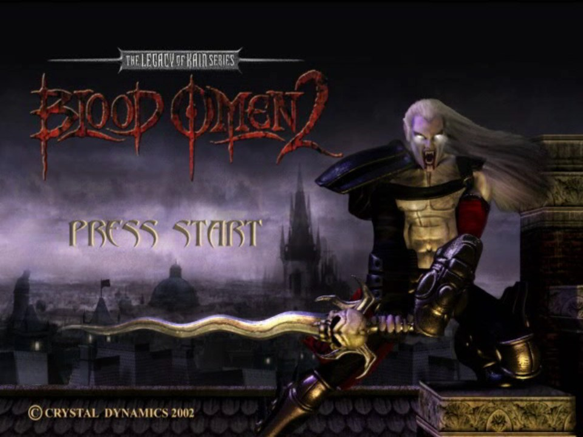
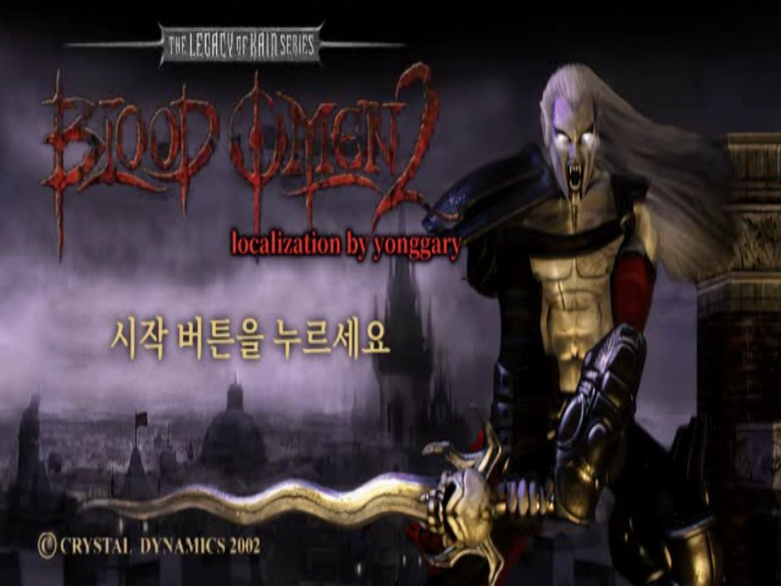
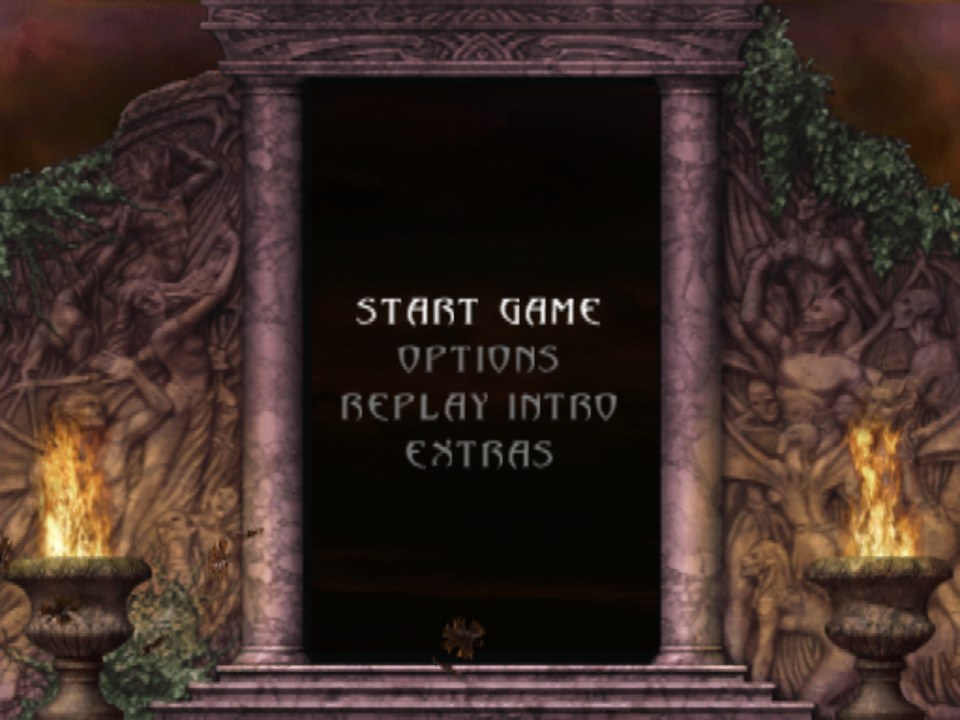
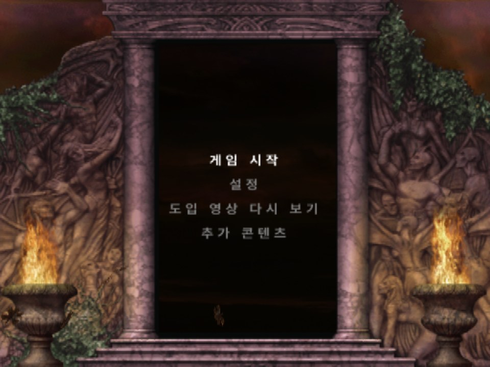
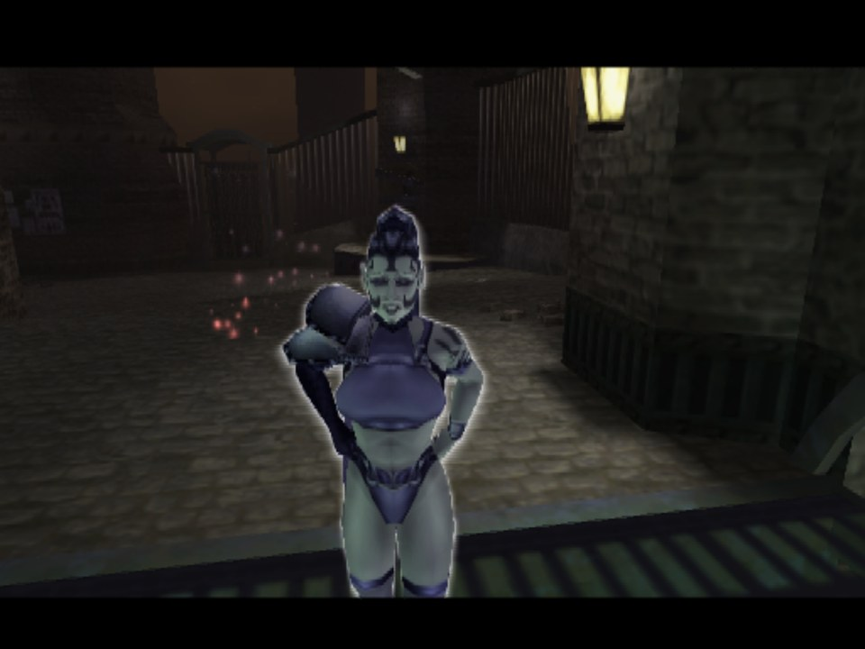
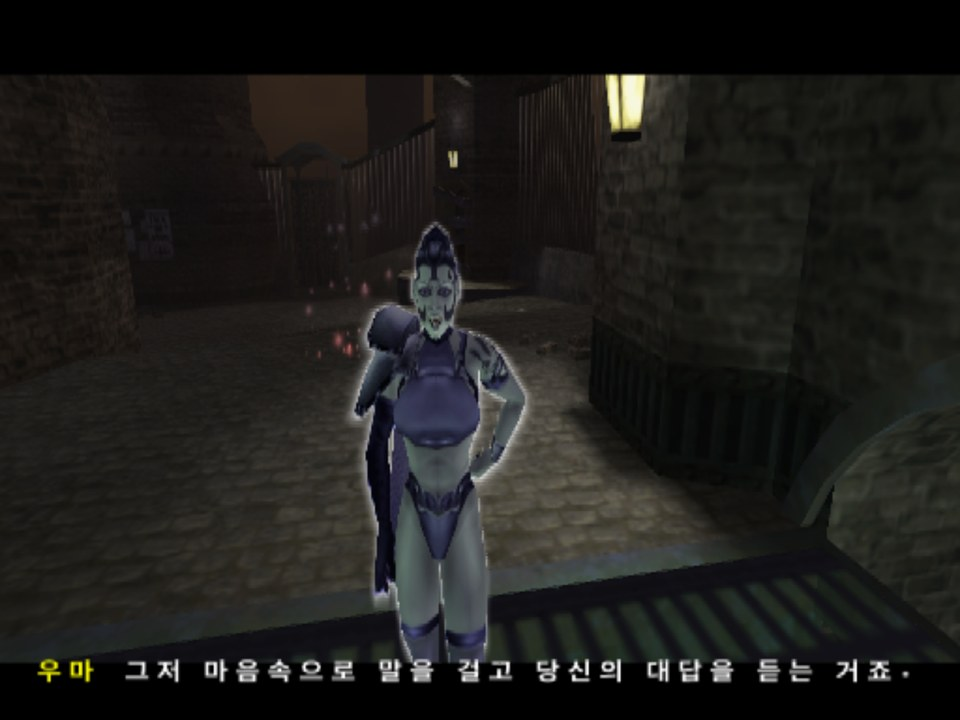
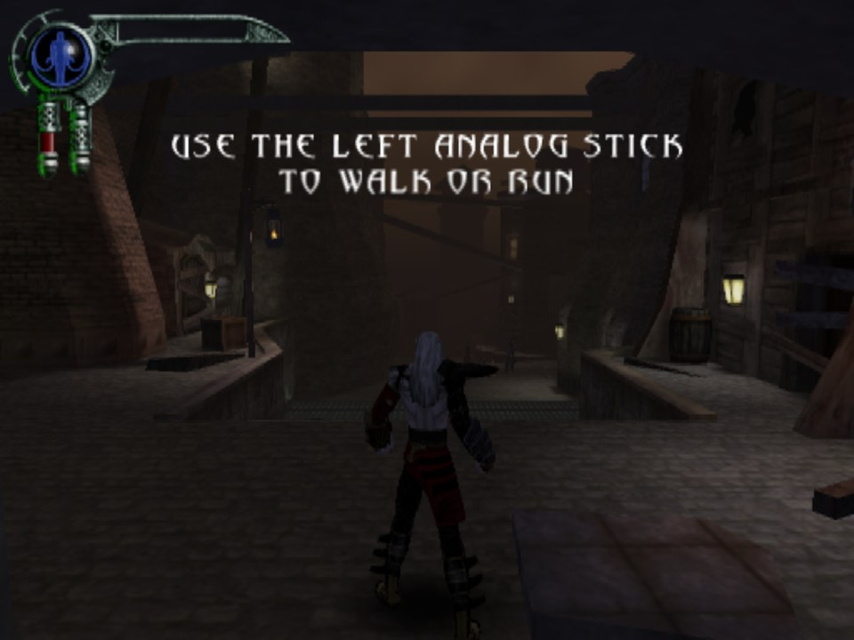
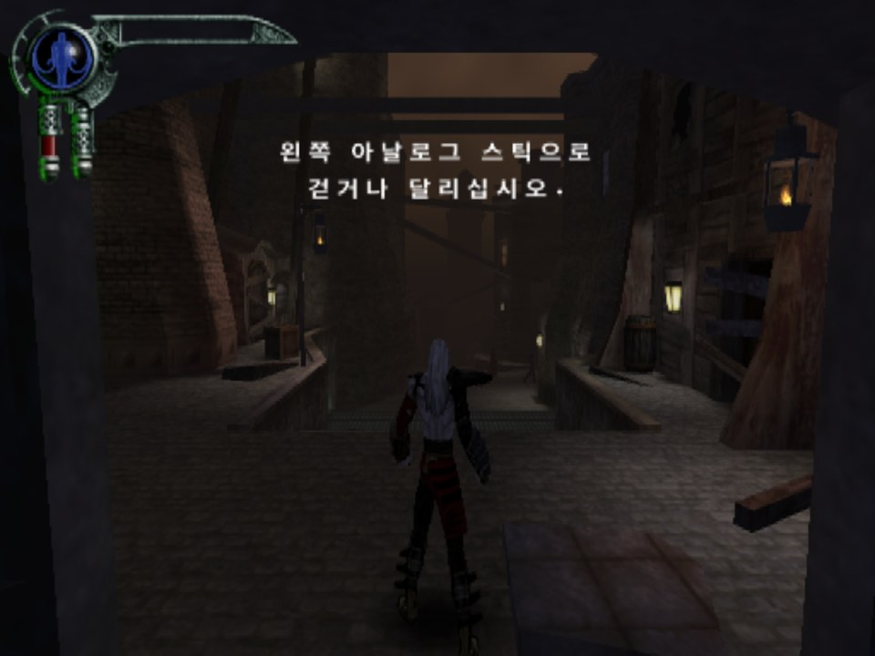

# 블러드 오멘 2 한글패치 (PS2 북미판)

**Blood Omen 2** (The Legacy of Kain Series) PS2 북미판 **SLUS-20024** 한글패치입니다.

> 본 한글패치는 개인이 제작한 비공식·비상업적 팬 한글패치입니다. — by **Yonggary6425 (용가리)**
> 게임 이미지(ISO)는 포함되어 있지 않습니다. 직접 소유한 원본으로만 사용해 주세요.

| 원본 북미판 | 한글패치 v1.0 |
|---|---|
|  |  |
|  |  |
|  |  |
|  |  |

---

## 주요 특징

- **메뉴·시스템 문구 한글화**: 주 메뉴, 설정, 일시정지, 저장·불러오기, 조작 안내문, 장 제목 화면
- **대사 한글 자막**: 원본 북미판은 컷신 대사에 자막이 없습니다. 화면 아래에 화자 이름과 대사를 한글로 표시합니다.
- **자막이 없던 음성에도 자막**: 전투 중 외침, 보스 대사, 지나가는 사람들의 말 등 1,051줄
- **배경 간판·포스터 22장** 한글화
- **한글 글꼴 844자** 추가, 숫자·영문·문장부호는 읽기 쉬운 고딕체로 다시 그림, 버튼 그림은 원본 그대로
- **16:9 화면**: 시야를 좌우로 넓혀 16:9로 그립니다 (에뮬레이터·TV를 16:9로 맞춰 주세요)
- **조작 체계 변경**: 왼쪽 스틱 = 앞뒤 이동 + 좌우 게걸음, 오른쪽 스틱 = 시점 회전
- 타이틀 화면 교체, 한글화 크레딧 화면, `localization by yonggary` 표기

자세한 원본 비교는 [`docs/블러드오멘2_한글패치현황_20261116_v1.0.pdf`](docs/) 를 참고하세요.

---

## 준비물

- PS2 북미판 원본 ISO: **Blood Omen 2 - The Legacy of Kain Series (USA)** / **SLUS-20024**
  - 크기 4,140,236,800 바이트, MD5 `d2b7f79118b1b881de5c999be826872d`
  - 크기와 MD5가 같은 원본에만 적용됩니다.
- Windows 10/11 (추가 설치 없음) 또는 Python 3.8 이상
- 빈 디스크 공간 약 3 GB

## 적용 방법

[Releases](../../releases) 에서 `BloodOmen2_KOR_Patch_v1.0.zip` 을 받아 압축을 풉니다.

### A. Windows

1. 원본 ISO 파일을 **`패치하기.bat`** 위에 끌어다 놓습니다.
2. 같은 폴더에 **`원본이름 (Korean).iso`** 가 새로 생깁니다. (원본 ISO는 그대로 둡니다)
3. `완료! (한글패치)` 가 나오면 성공입니다. 1~2분 걸립니다.

### B. Python (macOS / Linux)

```
python3 patch.py "Blood Omen 2 - The Legacy of Kain Series (USA).iso"
```

> 패처는 원본 ISO에서 바뀌지 않은 부분을 읽어 오고, 달라진 부분만 패치 데이터에서 채워 새 ISO를 만듭니다.
> 적용 전에 원본의 MD5를, 적용 후에 결과 파일의 MD5를 검사합니다.

## 주의

- **화면 비율**: 한글패치는 16:9로 그립니다. PCSX2는 화면 비율을 16:9로, 실기는 TV를 와이드로 맞춰 주세요. 4:3으로 두면 그림이 좌우로 눌려 보입니다.
- **조작 체계가 원본과 다릅니다.** 왼쪽 스틱 좌우가 회전이 아니라 게걸음이고, 시점은 오른쪽 스틱으로 돌립니다.
- **세이브 스테이트로 불러오면 이전 글꼴·문장이 보일 수 있습니다.** 메모리 카드 세이브로 불러오거나 새로 시작해 주세요.
- 이전 패치본에 다시 적용하지 말고, 항상 **원본 ISO** 에 적용해 주세요.
- 테스트 환경: PCSX2 v2.8.2 (실기에서는 확인하지 않았습니다)

## 알려진 사항

- **도입·결말 동영상과 추가 콘텐츠의 예고편에는 한글 자막이 없습니다.** 이 영상들은 원본 그대로입니다.
- 실제 화면으로 확인한 범위는 메뉴와 제1장 초반입니다. 그 뒤 구간의 자막, 전투 중 음성 자막, 간판의 게임 안 모습은 전부 확인하지 못했습니다.
- 안개 상태에서의 좌우 게걸음은 실제 플레이로 확인하지 못했습니다.
- 한글 글꼴 844자에 없는 글자는 표시되지 않습니다.

## 구성 파일

```
patcher/
  패치하기.bat        드래그 앤 드롭 실행 파일 (Windows)
  patch.ps1           적용기 본체 (Windows PowerShell 기본 기능)
  patch.py            Python 적용기
  bo2_kor.bin         패치 데이터 (두 적용기 공용)
docs/
  블러드오멘2_한글패치현황_20261116_v1.0.pdf
  screenshots/
```

## 크레딧

- 한글화·패처 제작: **Yonggary6425 (용가리)**
- 한글 글꼴: Noto Sans KR · Noto Serif KR (SIL Open Font License 1.1) 등
- 원작: Blood Omen 2 © 2002 Crystal Dynamics / Eidos Interactive. 모든 권리는 원저작권자에게 있습니다.

## 버그 제보

오역·오탈자·표시 문제는 [Issues](../../issues) 에 장면(장·상황)과 스크린샷을 함께 올려 주세요.
